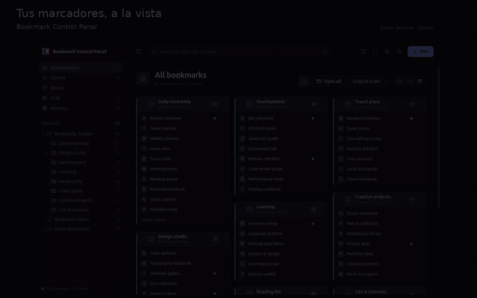
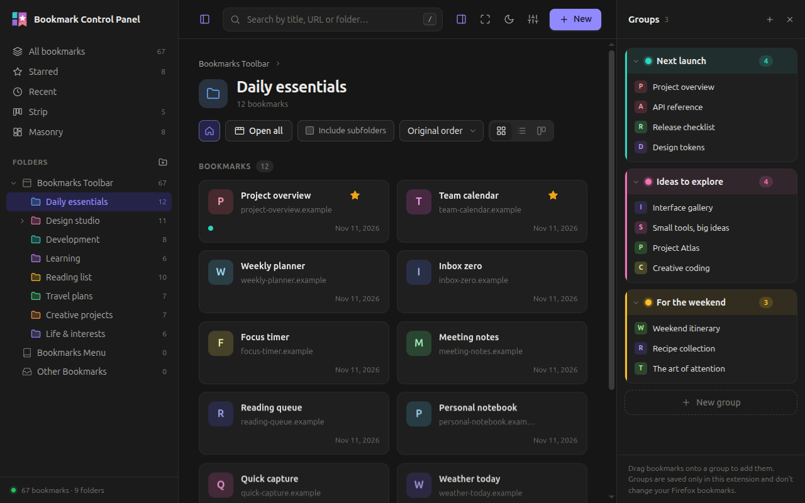
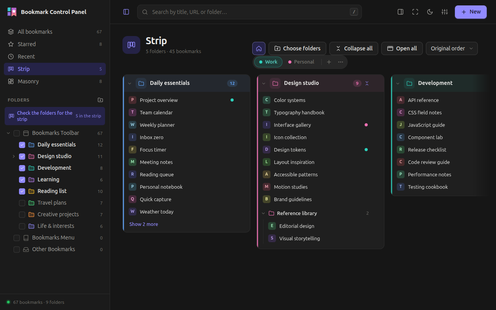
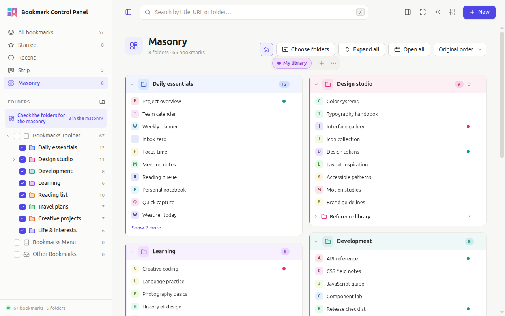
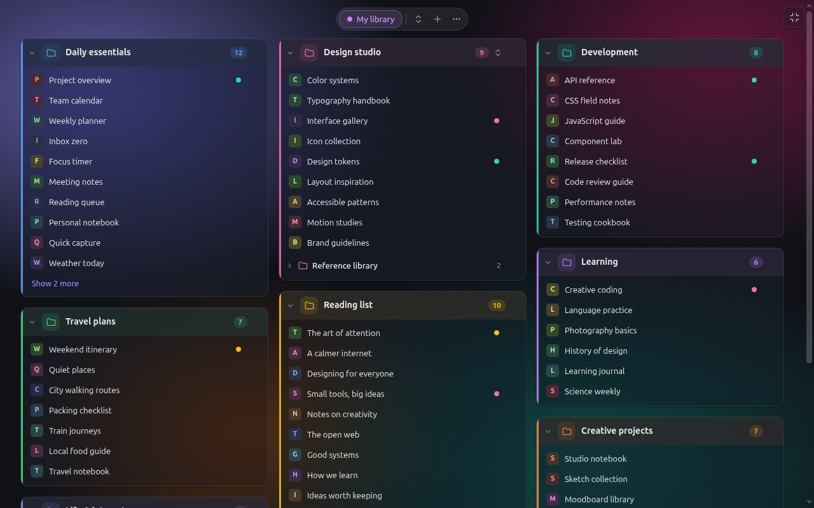

<p align="center">
  
</p>

<h1 align="center">Bookmark Control Panel</h1>

<p align="center">
  A calmer home for your bookmarks.<br />
  Your real Firefox folders, a visual workspace, and a new tab that feels like yours.
</p>

<p align="center">
  
  
  
</p>

<p align="center">
  <a href="store/media/presentation-es.mp4">Watch the demo</a> ·
  <a href="#get-started">Get started</a> ·
  <a href="docs/GUIDE.md">Guide</a> ·
  <a href="https://github.com/Mgldvd/Bookmark-Control-Panel/issues">Feedback</a>
</p>

[](store/media/presentation-es.mp4)

<p align="center"><a href="store/media/presentation-es.mp4">▶ Watch the 15-second video</a> · Spanish · Sample data</p>

## Find your flow

- **See it your way.** Grid, List, Board, horizontal Strip, or Masonry.
- **Keep projects together.** Profiles, personal groups, stars, and colored folders.
- **Move fast.** Instant search, drag and drop, bulk actions, and undo.
- **Make it yours.** Light and dark themes, four styles, backgrounds, and minimal mode.

## A closer look

<table>
  <tr>
    <td width="50%"><a href="store/media/02-grid-and-groups.png"></a><br /><strong>Projects at a glance</strong><br />Your folders, with personal groups alongside.</td>
    <td width="50%"><a href="store/media/04-strip-profiles.png"></a><br /><strong>Switch your context</strong><br />Separate profiles for work and everything else.</td>
  </tr>
  <tr>
    <td><a href="store/media/05-masonry.png"></a><br /><strong>Room for your whole library</strong><br />Balanced columns that make browsing easy.</td>
    <td><a href="store/media/06-minimal-gradient.png"></a><br /><strong>A little less distraction</strong><br />Just your links, your colors, your space.</td>
  </tr>
</table>

<p align="center"><a href="store/media">Explore all 11 screenshots →</a></p>

## Get started

Requires **Firefox 142+**. Check the [release status](store/PUBLICATION.md) or
[load it temporarily](docs/GUIDE.md#5-installing-for-testing-aboutdebugging) to try it locally.

Open a new tab, click the toolbar icon, or press **Alt + Shift + B**.
The extension replaces your new tab page; it uses your existing Firefox bookmarks.

## Private by default

No analytics, ads, or developer server. Organization stays local.
Favicons start off; optional icons and remote backgrounds contact external services.
[Read the privacy policy →](store/privacy-en.md)

<details>
<summary><strong>Build & contribute</strong></summary>

```sh
npm ci
npm run check
./package.sh
```

Packaging requires Python 3. The extension has no runtime dependencies.
See the [full guide](docs/GUIDE.md) for setup, architecture, shortcuts, and troubleshooting.

</details>
